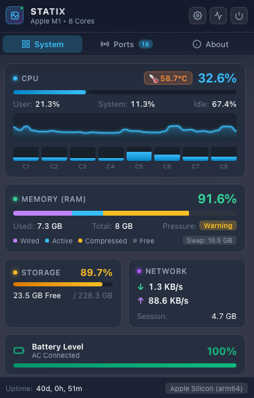
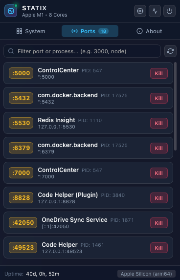
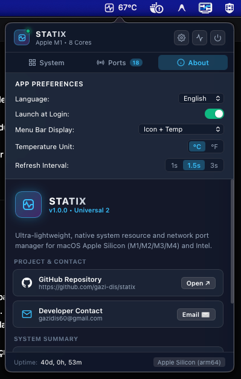

# Statix ⚡

<p align="center">
  
</p>

<h3 align="center">Ultra-Lightweight macOS Menu Bar System Monitor & Network Port Manager</h3>

<p align="center">
  <b>Native macOS application built with Objective-C, Cocoa, and WebKit.</b><br>
  Designed for Apple Silicon (M1/M2/M3/M4) and Intel (x86_64) Macs with zero bloat and near-zero CPU footprint.
</p>

<p align="center">
  <a href="#-key-features">Features</a> •
  <a href="#-visual-showcase">Screenshots</a> •
  <a href="#-installation">Installation</a> •
  <a href="#-multi-language-support">Languages</a> •
  <a href="#-port-manager-workflow">Port Manager</a> •
  <a href="#-building-from-source">Build</a> •
  <a href="#-contact--developer">Contact</a>
</p>

<p align="center">
  
  
  
  
  
</p>

---

## 📸 Visual Showcase

### 1. System Dashboard
> Real-time monitoring of CPU load, live temperature sensors, per-core utilization meters, memory pressure, storage, network throughput, battery status, and top resource-consuming processes.

<p align="center">
  
</p>

---

### 2. Network Port Manager & Process Termination
> Search active TCP listening ports and terminate conflicting processes holding your ports (`:3000`, `:5000`, `:8080`, etc.) with a single click.

<p align="center">
  
</p>

---

### 3. Menu Bar Integration & Quick Preferences
> Configurable menu bar text (CPU %, Temperature, RAM, Net speed), temperature unit toggle (°C / °F), refresh intervals, launch-at-login preference, and multi-language switcher.

<p align="center">
  
</p>

---

## ✨ Key Features

- ⚡ **Ultra-Lightweight & Native:** Pure Objective-C / Cocoa with Mach Kernel and IOKit system calls. No Electron, no Node runtime. Consumes less than **25 MB RAM** and **~0.1% CPU**.
- 🌡️ **CPU Temperature Telemetry:** Reads hardware temperature directly via `IOHIDEventSystemClient` (Apple Silicon SoC Die / Performance & Efficiency cores) and `AppleSMC` (Intel). Supports both **°C** and **°F**.
- 🔌 **Built-in Port Manager:** Instantly see what service is listening on which port. Stop wrestling with `lsof -i :PORT` or terminal `kill -9` commands.
- 🌐 **Multi-Language Support (i18n):** Fully localized in **English** (default), **Turkish (Türkçe)**, **German (Deutsch)**, **Spanish (Español)**, and **French (Français)**.
- 📊 **Per-Core Visualization:** Dynamic core activity meters adapt automatically whether running on an 8-core M1/M2/M3 or a multi-core Intel Xeon/i9.
- 🧠 **Memory Breakdown & Pressure:** Shows active, wired, compressed, and free memory alongside macOS memory pressure state (Normal / Warning / Critical) and swap usage.
- 🚀 **Launch at Login:** Enabled by default for seamless background monitoring from boot, toggleable anytime via the Settings drawer.
- 🎯 **Configurable Menu Bar Modes:**
  - `Icon + CPU %`
  - `Icon + CPU & Temperature`
  - `Icon + Temperature`
  - `Icon + CPU & RAM %`
  - `Icon + Network Speed`
  - `Icon Only` (Minimalist)
- 📦 **Universal 2 Binary:** Native binary slices for both **Apple Silicon (arm64)** and **Intel (x86_64)**.

---

## 🔌 Port Manager Workflow

### The Problem
Every developer encounters this error:
```bash
Error: listen EADDRINUSE: address already in use :::3000
```
Fixing this usually requires opening a terminal, querying the system with `lsof -i :3000`, finding the PID, and running `kill -9 <PID>`.

### The Statix Solution
1. Switch to the **Ports** tab in Statix.
2. Type `3000` (or `node`, `docker`, `python`) in the filter bar.
3. Click **Kill** (`Sonlandır`) on the process card.
4. Click **Confirm?** to safely terminate the process and immediately free the port.

---

## 🌐 Multi-Language Support

Statix supports 5 languages with live UI switching (no app restart required):
- **English** (`en`) — *Default*
- **Türkçe** (`tr`)
- **Deutsch** (`de`)
- **Español** (`es`)
- **Français** (`fr`)

Your chosen language is automatically persisted to macOS preferences (`NSUserDefaults`) and synchronizes both the popup interface and the native status item right-click context menu.

---

## 📥 Installation

### Method 1: DMG Installer (Recommended)
1. Download the latest release: [**Statix-Universal.dmg**](dist/Statix-Universal.dmg)
2. Open the DMG file and drag **Statix.app** into your **Applications** folder.
3. Launch **Statix** from Spotlight or your Applications folder.

---

### ⚠️ macOS Gatekeeper / First Launch Notice

Because **Statix** is a free, independent open-source project without a paid commercial Apple Developer ID ($99/year), macOS Gatekeeper displays a standard security verification warning when opening files downloaded from GitHub:

> *"Apple cannot verify that Statix.app is free of malware..."* / *"Apple, “Statix.app” öğesinin Mac’inize zarar verebilecek bir kötü amaçlı yazılım içermediğini doğrulayamadı."*

This is completely normal for open-source Mac software. You can easily approve it in **one of two quick ways**:

#### 🟢 Option A: Right-Click to Open (No Terminal Required • Recommended)
1. In **Finder**, open your **Applications** folder.
2. **Right-click** (or hold <kbd>Control</kbd> and click) on **Statix.app**.
3. Select **Open** from the context menu.
4. An alert will appear, but this time it includes an **Open** button. Click **Open**.
5. *macOS remembers your permission permanently — future launches will open instantly.*

*(Alternatively, go to **System Settings  > Privacy & Security**, scroll down to the Security section, and click **"Open Anyway"**).*

#### 💻 Option B: Terminal Command (One-Liner)
Remove the internet download quarantine attribute attached by macOS:
```bash
xattr -cr /Applications/Statix.app
```
Then double-click **Statix** to launch normally.

---

## 🛠️ Building From Source

### Prerequisites
- macOS 11.0 (Big Sur) or later
- Xcode Command Line Tools:
  ```bash
  xcode-select --install
  ```

### Build Commands
Clone the repository and compile the Universal 2 binary with a single script:

```bash
# Clone the repository
git clone https://github.com/gazi-dis/statix.git
cd statix

# Compile Universal 2 binary and package application
./build.sh

# Or build and launch directly:
make run
```

### Build DMG Installer
```bash
./tools/create_dmg.sh
# Output located at: dist/Statix-Universal.dmg
```

---

## 📁 Repository Structure

```
statix/
├── assets/
│   ├── AppIcon.icns              # Multi-resolution macOS icon bundle
│   ├── AppIcon.png               # High-res icon asset
│   ├── menubar_icon.png          # Template icon for status bar
│   └── screenshots/              # Presentation screenshots
│       ├── screenshot-dashboard.png
│       ├── screenshot-ports.png
│       └── screenshot-settings.png
├── dist/
│   ├── Statix-Universal.dmg      # Ready-to-use drag-and-drop installer
│   ├── Statix-Universal.zip      # Standalone zip archive
│   └── Statix.app                # Compiled Universal 2 application
├── src/
│   ├── AppDelegate.h / .m        # Menu bar item, popover lifecycle, i18n menu, bridge
│   ├── SystemMonitor.h / .m      # Mach kernel, IOKit SMC/HID thermal, proc port scanner
│   ├── main.m                    # Application entry point
│   ├── Info.plist                # macOS bundle configuration (LSUIElement = YES)
│   └── web/
│       ├── index.html            # Dashboard, Port Manager & About tabs
│       ├── style.css             # Glassmorphism styling, responsive layout
│       └── app.js                # Frontend controller, sparkline, i18n dictionaries
├── tools/
│   ├── create_dmg.sh             # DMG package generation script
│   ├── generate_icons.m          # Programmatic icon generator
│   └── pack_icns.py              # Apple ICNS binary packer
├── build.sh                      # Clang Universal 2 build pipeline
└── Makefile                      # Build automation shortcuts
```

---

## 🏗️ Technical Architecture

Statix is engineered for maximum performance and minimum overhead:

```
┌────────────────────────────────────────────────────────┐
│                   macOS Status Bar                     │
│               [⚡ 37.9%  🌡️ 51.8°C]                    │
└──────────────────────────┬─────────────────────────────┘
                           │ Click / Shortcut
┌──────────────────────────▼─────────────────────────────┐
│                 NSPopover + WKWebView                  │
│       HTML5 Canvas Sparkline + Modern Glass UI         │
└──────────────────────────┬─────────────────────────────┘
                           │ WebKit Native Script Bridge
┌──────────────────────────▼─────────────────────────────┐
│                 AppDelegate (Cocoa)                    │
│      NSStatusBarItem • NSUserDefaults • Preferences    │
└──────────────────────────┬─────────────────────────────┘
                           │
        ┌──────────────────┴──────────────────┐
        │                                     │
┌───────▼──────────────┐             ┌────────▼──────────────┐
│  Mach Kernel / IOKit │             │   libproc / Sockets   │
│  • host_processor_info             │   • proc_listpids     │
│  • vm_statistics64                 │   • proc_pidinfo      │
│  • IOHIDEventSystemClient          │   • TCP LISTEN filter │
│  • AppleSMC thermal keys           │   • kill(pid, SIGTERM)│
└──────────────────────┘             └───────────────────────┘
```

---

## 📄 License

This project is licensed under the **MIT License** — feel free to use, modify, and distribute.

---

## 👤 Author & Contact

- **Developer:** Gazi Diş
- **GitHub:** [@gazi-dis](https://github.com/gazi-dis)
- **Repository:** [https://github.com/gazi-dis/statix](https://github.com/gazi-dis/statix)
- **Email:** [gazidis60@gmail.com](mailto:gazidis60@gmail.com)
